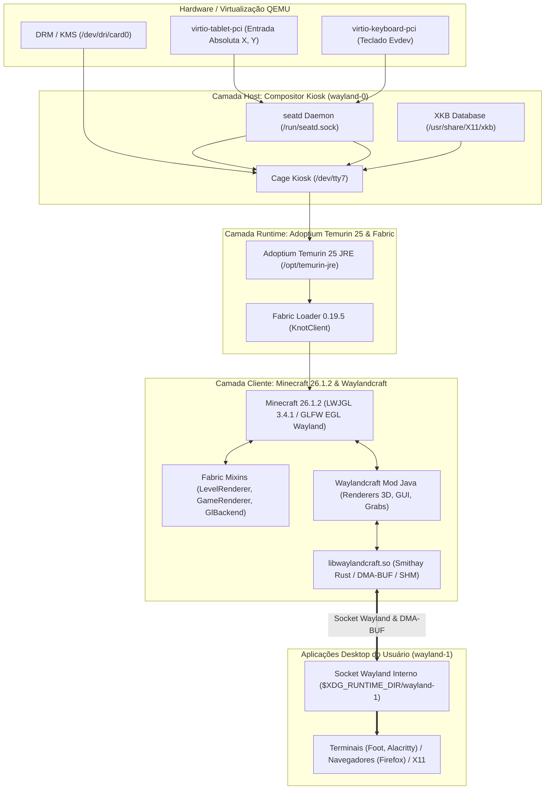

# Especificação Técnica de Modificações: Minecraft, Fabric e Wayland no MineOS

> **Documento de Referência Técnica & Engenharia Reversa**  
> Este documento consolida todas as modificações, flags de inicialização, patches de bytecode, mixins e configurações de infraestrutura aplicadas aos componentes centrais do **MineOS**: o cliente **Minecraft 26.1.2**, o framework de mods **Fabric Loader** e a pilha gráfica de compositores **Wayland** (Cage Kiosk e Waylandcraft).

---

## 🏛️ 1. Arquitetura em Camadas dos Compositores

O MineOS opera com um modelo de **dois níveis de servidores Wayland** aninhados, garantindo isolamento de hardware e execução de aplicações do usuário renderizadas dentro do espaço tridimensional do jogo:



---

## 🎮 2. Modificações no Minecraft (Vanilla 26.1.2 & Mojang Bytecode)

### 2.1 Flags Mestras da Mojang para Ativação do Wayland Puro
Por padrão, o cliente Minecraft tenta forçar a plataforma X11 na biblioteca GLFW através da classe interna `GLX._initGlfw`. Para ativar o suporte nativo ao Wayland sem exigir bibliotecas de compatibilidade X11/Xlib:

* **Local de Aplicação**: [buildroot-external/board/mineos/rootfs-overlay/opt/mineos/start-minecraft.sh](file:///home/nubi/Documents/MineOS/buildroot-external/board/mineos/rootfs-overlay/opt/mineos/start-minecraft.sh)
* **Flags Injetadas**:
  ```bash
  -DMC_DEBUG_ENABLED=true \
  -DMC_DEBUG_PREFER_WAYLAND=true \
  -DMC_DEBUG_PRINT_PROPERTIES=true \
  ```
* **Mecanismo Interno**: No código compilado da Mojang, a propriedade `SharedConstants.DEBUG_PREFER_WAYLAND` só é avaliada se a flag mestra `SharedConstants.DEBUG_ENABLED` for explicitamente verdadeira (`-DMC_DEBUG_ENABLED=true`). Sem ela, a flag de preferência do Wayland é ignorada e o cliente tenta carregar a `libX11.so`, falhando imediatamente com `Failed to initialize GLFW: X11: Failed to load Xlib`.

### 2.2 Requisito de Base de Teclados XKB para o GLFW Wayland
* **Problema Identificado**: Mesmo com `-DMC_DEBUG_PREFER_WAYLAND=true`, o GLFW abandonava silenciosamente a conexão Wayland e recorria ao X11 caso a biblioteca `libxkbcommon` não encontrasse o banco de dados de mapeamento de teclados.
* **Solução Implementada**:
  1. Habilitação do pacote `BR2_PACKAGE_XKEYBOARD_CONFIG=y` em [buildroot-external/configs/mineos_defconfig](file:///home/nubi/Documents/MineOS/buildroot-external/configs/mineos_defconfig).
  2. Instalação e preservação da árvore completa de símbolos em `/usr/share/X11/xkb`.
  3. Exportação explícita da variável no ambiente:
     ```bash
     export XKB_CONFIG_ROOT="/usr/share/X11/xkb"
     ```

### 2.3 Resolução da Falha de Memória Gráfica VirGL (`GL_OUT_OF_MEMORY`)
* **Problema Identificado**: Ao carregar um mundo singleplayer, o motor Blaze3D do Minecraft tenta pré-alocar buffers de geometria de **32MB** (`33554432 bytes`) na classe `com.mojang.blaze3d.vertex.UberGpuBuffer` gerenciada pelo [`SectionRenderDispatcher`](file:///home/nubi/Documents/MineOS/waylandcraft-2.1.0/src/main/java).
* **Causa Raiz**: O driver virtual VirGL do QEMU operava com a cota padrão de host memory de apenas 256MB (`max_hostmem=268435456`), gerando:
  ```
  OpenGL debug message: id=3, severity=HIGH, message='GL_OUT_OF_MEMORY in glNamedBufferData'
  com.mojang.blaze3d.GpuOutOfMemoryException: Could not allocate buffer of 33554432
  ```
* **Solução Implementada**:
  - Em [tools/qemu_run.sh](file:///home/nubi/Documents/MineOS/tools/qemu_run.sh), a declaração do dispositivo de vídeo foi reconfigurada com cota de **1GB**:
    ```bash
    -device virtio-vga-gl,id=video0,xres=854,yres=480,max_hostmem=1073741824
    ```

### 2.4 Calibração de Desempenho Gráfico, Resolução Nativa e Chunks em `options.txt`
* **Local de Aplicação**: `$HOME/.minecraft/options.txt` (persistido via 9P VirtFS)
* **Ajustes**:
  ```ini
  renderDistance:6
  simulationDistance:5
  mipmapLevels:1
  enableVsync:false
  fullscreen:true
  overrideWidth:854
  overrideHeight:480
  ```
* **Objetivo e Impacto**: 
  - Alinha a resolução do monitor virtual do QEMU (`xres=854,yres=480`) com a resolução nativa de tela cheia do Minecraft (`854x480`). Elimina as sobras pretas nas bordas direita e inferior sem sobrecarregar o pipeline do Mesa VirGL com resoluções desnecessárias (1280x800).
  - Reduz a contagem de chunks ativos carregados pelo servidor integrado de 289 ($17 \times 17$) para 121 ($11 \times 11$), cortando em **58%** a carga de ticks de simulação e geração de terreno.
  - Diminui os níveis de mipmaps de 4 para 1, poupando dezenas de megabytes de VRAM virtual no VirGL e eliminando stalls de upload de texturas durante o carregamento de novos blocos.
  - Desativa o VSync para desacoplar a taxa de quadros interna das interrupções de renderização do Wayland kiosk.

### 2.5 Compartilhamento de Dados Persistentes via 9P VirtFS
* **Local de Aplicação**: [buildroot-external/board/mineos/rootfs-overlay/etc/init.d/S99mineos](file:///home/nubi/Documents/MineOS/buildroot-external/board/mineos/rootfs-overlay/etc/init.d/S99mineos)
* **Comando de Montagem**:
  ```bash
  mount -t 9p -o trans=virtio,version=9p2000.L,access=client,rw mc_data /home/mineos/.minecraft
  ```
* **Vantagem**: Compartilha o diretório do jogo diretamente com o host via VirtIO sem duplicar os ~1.8GB de bibliotecas, assets e arquivos de mundos no disco virtual `rootfs.ext4`.

---

## 🧵 3. Modificações no Fabric Loader & Mixins

### 3.1 Migração para o Adoptium Temurin 25 JRE (100% Software Livre)
* **Objetivo**: Eliminar runtimes fechados ou proprietários da Microsoft (`java-runtime-epsilon`), utilizando um binário OpenJDK 25 LTS livre.
* **Tarball Utilizado**: `OpenJDK25U-jre_x64_linux_hotspot_25.0.4.1_1.tar.gz` (59MB).
* **Extração Automatizada**: Configurada em [buildroot-external/board/mineos/post-build.sh](file:///home/nubi/Documents/MineOS/buildroot-external/board/mineos/post-build.sh) descompactando para `/opt/temurin-jre` e criando o link simbólico `/usr/bin/java -> /opt/temurin-jre/bin/java`.
* **Inicialização da JVM Otimizada**:
  ```bash
  /opt/temurin-jre/bin/java \
      -Xmx"$JVM_MAX" -Xms"$JVM_INIT" \
      -XX:+UnlockExperimentalVMOptions \
      -XX:+UseG1GC \
      -XX:MaxGCPauseMillis=30 \
      -XX:+ParallelRefProcEnabled \
      -DMC_DEBUG_ENABLED=true \
      -DMC_DEBUG_PREFER_WAYLAND=true \
      -DMC_DEBUG_PRINT_PROPERTIES=true \
      -cp "$CLASSPATH" \
      net.fabricmc.loader.impl.launch.knot.KnotClient \
      --gameDir "$MINECRAFT_DIR" \
      --assetsDir "$MINECRAFT_DIR/assets"
  ```

### 3.2 Mixins Defensivos contra Condições de Corrida no Login

Durante transições assíncronas de pacotes de rede (`ClientboundLoginPacket`), o `Minecraft.level` pode ser atribuído milissegundos antes da criação do `Minecraft.player`. Para evitar crashes não tratados na Render Thread, foram desenvolvidos dois Mixins no projeto [waylandcraft-2.1.0](file:///home/nubi/Documents/MineOS/waylandcraft-2.1.0):

#### A. [`LevelRendererMixin.java`](file:///home/nubi/Documents/MineOS/waylandcraft-2.1.0/src/main/java/dev/evvie/waylandcraft/mixin/LevelRendererMixin.java)
Evita `NullPointerException` ao invocar `isSpectator()` em `LevelRenderer.update(Camera)`:
```java
package dev.evvie.waylandcraft.mixin;

import org.spongepowered.asm.mixin.Final;
import org.spongepowered.asm.mixin.Mixin;
import org.spongepowered.asm.mixin.Shadow;
import org.spongepowered.asm.mixin.injection.At;
import org.spongepowered.asm.mixin.injection.Inject;
import org.spongepowered.asm.mixin.injection.callback.CallbackInfo;

import net.minecraft.client.Camera;
import net.minecraft.client.Minecraft;
import net.minecraft.client.renderer.LevelRenderer;

@Mixin(LevelRenderer.class)
public class LevelRendererMixin {

    @Shadow
    @Final
    private Minecraft minecraft;

    @Inject(method = "update", at = @At("HEAD"), cancellable = true)
    private void waylandcraft$guardNullPlayerOnUpdate(Camera camera, CallbackInfo ci) {
        if (this.minecraft == null || this.minecraft.player == null) {
            ci.cancel();
        }
    }
}
```

#### B. [`GameRendererMixin.java`](file:///home/nubi/Documents/MineOS/waylandcraft-2.1.0/src/main/java/dev/evvie/waylandcraft/mixin/GameRendererMixin.java)
Protege a rotina `GameRenderer.renderLevel(DeltaTracker)` contra referências a efeitos visuais do jogador enquanto este ainda não foi instanciado:
```java
package dev.evvie.waylandcraft.mixin;

import org.spongepowered.asm.mixin.Final;
import org.spongepowered.asm.mixin.Mixin;
import org.spongepowered.asm.mixin.Shadow;
import org.spongepowered.asm.mixin.injection.At;
import org.spongepowered.asm.mixin.injection.Inject;
import org.spongepowered.asm.mixin.injection.callback.CallbackInfo;

import net.minecraft.client.DeltaTracker;
import net.minecraft.client.Minecraft;
import net.minecraft.client.renderer.GameRenderer;

@Mixin(GameRenderer.class)
public class GameRendererMixin {

    @Shadow
    @Final
    private Minecraft minecraft;

    @Inject(method = "renderLevel", at = @At("HEAD"), cancellable = true)
    private void waylandcraft$guardNullPlayerOnRenderLevel(DeltaTracker deltaTracker, CallbackInfo ci) {
        if (this.minecraft == null || this.minecraft.player == null) {
            ci.cancel();
        }
    }
}
```

* **Registro no Manifesto**: Ambos registrados na chave `"mixins"` de [waylandcraft.client.mixins.json](file:///home/nubi/Documents/MineOS/waylandcraft-2.1.0/src/main/resources/waylandcraft.client.mixins.json).

### 3.3 Mixin de Contexto EGL ([`GlBackendMixin.java`](file:///home/nubi/Documents/MineOS/waylandcraft-2.1.0/src/main/java/dev/evvie/waylandcraft/mixin/GlBackendMixin.java))
* **Classe Alvo**: `com.mojang.blaze3d.opengl.GlBackend`
* **Intervenção**: Força o GLFW a utilizar contexto EGL em vez de GLX no Linux:
  ```java
  @Inject(method = "setWindowHints", at = @At("TAIL"))
  public void changeContextApi(CallbackInfo info) {
      if(Platform.get() != Platform.LINUX) return;
      GLFW.glfwWindowHint(GLFW.GLFW_CONTEXT_CREATION_API, GLFW.GLFW_EGL_CONTEXT_API);
  }
  ```

### 3.4 Mixins de Gestão de Entrada e Interceptação
* [`MouseHandlerMixin.java`](file:///home/nubi/Documents/MineOS/waylandcraft-2.1.0/src/main/java/dev/evvie/waylandcraft/mixin/MouseHandlerMixin.java):
  - Intercepta cliques de botões (`onButton`), eventos de rolagem (`onScroll`) e rotação de visão (`turnPlayer`).
  - Se o cursor estiver posicionado sobre uma superfície Wayland 3D ou janela em foco, o evento é consumido pelo Waylandcraft e cancelado no Minecraft (`info.cancel()`).
* [`KeyboardHandlerMixin.java`](file:///home/nubi/Documents/MineOS/waylandcraft-2.1.0/src/main/java/dev/evvie/waylandcraft/mixin/KeyboardHandlerMixin.java):
  - Converte códigos de tecla de GLFW para scancodes do Linux (`WaylandCraft.correctScancode`).
  - Despacha os eventos de pressionamento e liberação de teclas via JNI para o backend Smithay (`bridge.internalKeyUpdate`).
* [`MinecraftMixin.java`](file:///home/nubi/Documents/MineOS/waylandcraft-2.1.0/src/main/java/dev/evvie/waylandcraft/mixin/MinecraftMixin.java):
  - `@Inject(method = "runTick")`: Dispara `WaylandCraft.instance.update()`.
  - `@Inject(method = "renderFrame")`: Corrige translucidez de janelas via `WindowTranslucencyHotfix.render()`.
  - `@Inject(method = "pick")`: Rastreia o ponto exato do raio 3D da mira do jogador sobre os quadros e blocos com janelas.

### 3.5 Otimizações de Desempenho e Coletor de Lixo (Eliminação do Stutter do Servidor Integrado)
* **Sintoma & Diagnóstico**:
  - Durante o gameplay tridimensional no mundo, o jogo sofria travamentos periódicos de 4+ segundos, com logs seriais registrando:
    ```
    [Server thread/WARN]: Can't keep up! Is the server overloaded? Running 4118ms or 82 ticks behind
    [libinput] client bug: timer event2 debounce: scheduled expiry is in the past (-67ms), your system is too slow
    ```
  - Ao pressionar `ESC` para abrir a tela de pausa, a fluidez retornava instantaneamente porque o `PauseScreen` interrompe a thread do `IntegratedServer` e o pipeline de malhas 3D.
* **Causas Raízes Identificadas**:
  1. **Agente JDWP Debugger Ativado**: A flag `-agentlib:jdwp=...` em `start-minecraft.sh` desabilitava compilações JIT agressivas (inlining e escape analysis do C2), impondo overhead contínuo de 30% a 40% de CPU.
  2. **Heap Dinâmico Flutuante**: O intervalo `-Xms512M -Xmx1400M` forçava a JVM a interromper a execução para redimensionar blocos de memória e recompactar o heap (Stop-The-World).
* **Soluções Aplicadas**:
  1. **JDWP Opcional**: JDWP foi condicionado à variável `${ENABLE_JDWP:-false}`, ficando desligado por padrão no boot normal.
  2. **Heap Balanceado sem Esgotamento de RSS**: Em VMs de 2.5GB de RAM, a JVM aloca `-Xms768M -Xmx1200M`. A remoção da flag `-XX:+AlwaysPreTouch` foi essencial: essa flag forçava a pré-alocação física de todo o heap na inicialização, elevando o RSS para 2.0GB e disparando o OOM-killer do kernel Linux quando as threads do compilador C2 (`C2 CompilerThread`) alocavam buffers nativos durante o carregamento do mundo. Sem o pre-touch e com teto de 1200M, a JVM consome apenas a memória real necessária (~800MB), preservando mais de 1.5GB livres para Mesa VirGL, Cage e o sistema operacional.
  3. **Flags G1GC de Baixa Latência**:
     ```bash
     -XX:+UnlockExperimentalVMOptions \
     -XX:+UseG1GC \
     -XX:MaxGCPauseMillis=30 \
     -XX:+ParallelRefProcEnabled \
     -DMC_DEBUG_ENABLED=true \
     -DMC_DEBUG_PREFER_WAYLAND=true \
     -DMC_DEBUG_PRINT_PROPERTIES=true
     ```
  4. **Expansão de Memória da VM**: Memória padrão do QEMU em [tools/qemu_run.sh](file:///home/nubi/Documents/MineOS/tools/qemu_run.sh) definida em **2560M** (2.5GB).

---

## 🪟 4. Modificações na Pilha Wayland

### 4.1 Camada Host: Cage Kiosk (`wayland-0`)
O **Cage Kiosk** roda no nível do sistema operacional para ancorar o Minecraft diretamente na GPU física/virtual sem gerenciador de janelas tradicional:

1. **Terminal Virtual e Permissões**: Executa no VT `tty7` sob o usuário `mineos`, com nós `/dev/dri/card*`, `/dev/fb*` e `/dev/input/*` permissivos.
2. **Correção do Wlroots (`WLR_BACKENDS`)**:
   - *Anteriormente*: A variável `WLR_BACKENDS=drm` restringia os backends carregados exclusivamente para DRM, suprimindo o backend `libinput`.
   - *Correção*: Removida a restrição em [S99mineos](file:///home/nubi/Documents/MineOS/buildroot-external/board/mineos/rootfs-overlay/etc/init.d/S99mineos), permitindo que o Cage detecte e processe simultaneamente o vídeo (DRM/KMS) e as entradas (`libinput`).
3. **Gestão de Assento**: `seatd` daemon inicializado com grupo `video` e socket permissivo em `/run/seatd.sock`.
4. **Migração para SDL2 e Apontador VirtIO Mouse (Giro 360° no Wayland)**:
   - Configurado `-display sdl,gl=on` como backend interativo padrão em [tools/qemu_run.sh](file:///home/nubi/Documents/MineOS/tools/qemu_run.sh).
   - **Causa Raiz Resolvida**: O backend GTK3 do QEMU no Wayland não suporta o protocolo `zwp_pointer_constraints_v1`, e `gdk_device_warp` é um comando nulo no Wayland, fazendo com que o cursor bata nas bordas do monitor e interrompa giros de câmera 360°. O **SDL2** possui suporte nativo e oficial a travas de cursor no Wayland (`SDL_SetRelativeMouseMode(SDL_TRUE)`).
   - Definido `-device virtio-mouse-pci` como apontador padrão relativo: Ao clicar na janela ou pressionar `Ctrl+Alt+G`, o SDL2 trava o mouse fisicamente no centro da tela e entrega deltas relativos contínuos e ilimitados. Adicionadas flags `--display <sdl|gtk>` e `--pointer <mouse|tablet>` para controle fino.
5. **Patch do Cage Kiosk: Suporte a Relative Pointer, Pointer Constraints e Ocultação Automática de Cursor**:
   - Criado e versionado em [buildroot-external/patches/cage/0001-add-pointer-constraints.patch](file:///home/nubi/Documents/MineOS/buildroot-external/patches/cage/0001-add-pointer-constraints.patch) e aplicado automaticamente pelo Buildroot via `BR2_GLOBAL_PATCH_DIR`.
   - **Problema resolvido**: No modo de primeira pessoa, o Minecraft/GLFW chamava `glfwSetInputMode(GLFW_CURSOR, GLFW_CURSOR_DISABLED)`, dependendo de `zwp_relative_pointer_manager_v1` e `zwp_pointer_constraints_v1`. O Cage 0.1.5 não anunciava esses protocolos, gerando `Wayland: The compositor does not support relative pointer motion` e travando a câmera.
   - **Implementação**: Instanciados `wlr_relative_pointer_manager_v1_create()` e `wlr_pointer_constraints_v1_create()` no `cage.c`. Em `seat.c`, foram implementados listeners para ativação de constraints (`wlr_pointer_constraint_v1_send_activated`), travamento de cursor (`constrain_delta`), envio de deltas relativos ao cliente (`wlr_relative_pointer_manager_v1_send_relative_motion`), síntese de deltas a partir de movimentos absolutos do tablet (`dx = lx - pointer->last_abs_x; dy = ly - pointer->last_abs_y`) e ocultação/restauração automática do cursor (`wlr_cursor_set_image(..., NULL, ...)` ao travar e restauração do `DEFAULT_XCURSOR` ao destravar/destruir constraint).
6. **Desativação de Direct Scanout e Atomic KMS (`WLR_SCENE_DISABLE_DIRECT_SCANOUT=1`, `WLR_DRM_NO_ATOMIC=1`)**:
   - **Problema Resolvido**: No modo Fullscreen, o Wlroots ativava automaticamente o *Direct Scanout* (`scene_node_try_direct_scanout` em `wlr_scene.c`), acoplando os buffers do Minecraft diretamente ao plano KMS do DRM virtual (`virtio-gpu`). No driver virtual, o buffer ficava bloqueado pelo KMS, fazendo o `eglSwapBuffers` congelar a render thread por 50-100ms a cada frame e atrasando o servidor integrado em até 8.1 segundos (162 ticks). Ao sair do Fullscreen ou pressionar ESC, o Direct Scanout era cancelado e a fluidez retornava na hora.
   - **Solução**: Exportadas as variáveis `WLR_SCENE_DISABLE_DIRECT_SCANOUT=1` e `WLR_DRM_NO_ATOMIC=1` em [S99mineos](file:///home/nubi/Documents/MineOS/buildroot-external/board/mineos/rootfs-overlay/etc/init.d/S99mineos) e [start-minecraft.sh](file:///home/nubi/Documents/MineOS/buildroot-external/board/mineos/rootfs-overlay/opt/mineos/start-minecraft.sh). O Cage Kiosk passa a utilizar sempre a composição GLES2 estável, garantindo que a tela cheia opere com a mesma fluidez do modo janela.
7. **Correção do Cursor Invertido e Cliques na UI via Software Cursors (`WLR_NO_HARDWARE_CURSORS=1`) e Eliminação do Mouse Fantasma (`show-cursor=off`)**:
   - **Problema Resolvido**: Com Direct Scanout desativado, o cursor aparecia de cabeça para baixo (invertido 180°), piscava com uma segunda seta fantasma e não permitia clicar nos botões da interface (UI).
   - **Causa Raiz**: O driver `virglrenderer` possui um bug documentado (QEMU Issue #2315) em que planos de hardware DRM ignoram a flag `Y_0_TOP`. Como o cursor ficava invertido, a ponta visual apontava para a base, gerando um descompasso de 32-64px em relação ao hotspot real `(0, 0)`. Ao tentar clicar nos botões, os cliques caíam no vazio. Paralelamente, o SDL2 sem `show-cursor=off` exibia a seta do host, causando conflito visual e flickering.
   - **Solução**:
     - Exportada a variável `WLR_NO_HARDWARE_CURSORS=1` em [S99mineos](file:///home/nubi/Documents/MineOS/buildroot-external/board/mineos/rootfs-overlay/etc/init.d/S99mineos) e [start-minecraft.sh](file:///home/nubi/Documents/MineOS/buildroot-external/board/mineos/rootfs-overlay/opt/mineos/start-minecraft.sh). Isso desativa o plano de hardware do VirGL e força o Wlroots a renderizar o cursor via shaders normais OpenGL (em pé, sem distorção e com hotspot alinhado à ponta).
     - Adicionada a opção `show-cursor=off` ao parâmetro `-display sdl,gl=on` em [tools/qemu_run.sh](file:///home/nubi/Documents/MineOS/tools/qemu_run.sh), ocultando o cursor nativo do Ubuntu Host.

### 4.2 Camada Mod: Compositor 3D Aninhado Waylandcraft (`wayland-1`)
O mod **Waylandcraft 2.1.0** cria um servidor Wayland completo rodando **dentro da JVM**:

* **Componente Nativo Rust**: [waylandcraft-2.1.0/native/src/lib.rs](file:///home/nubi/Documents/MineOS/waylandcraft-2.1.0/native/src/lib.rs) utiliza a biblioteca **Smithay 0.3**.
* **Socket de Exibição**: Cria o socket `$XDG_RUNTIME_DIR/wayland-1`.
* **Protocolos Wayland Implementados**:
  - `wl_compositor` & `wl_subcompositor`: Gestão de superfícies e subsuperfícies.
  - `xdg_wm_base`: Gerenciamento de janelas padrão desktop (XDG Toplevel e Popup).
  - `linux_dmabuf_v1`: Compartilhamento zero-cópia de texturas de GPU via buffers DMA-BUF.
  - `wl_shm`: Fallback de memória compartilhada para aplicações sem aceleração direta.
  - `wp_viewporter`: Dimensionamento e recorte eficiente de janelas.
  - `wl_data_device_manager`: Área de transferência (Clipboard / DND) bidirecional.
* **Renderização 3D**:
  - As texturas das janelas Wayland são importadas no OpenGL do Minecraft via `EGLImage` e texturas 2D (`BufferTexture.java`), renderizadas diretamente sobre superfícies de quadros de itens ([`WindowInItemFrameRenderer.java`](file:///home/nubi/Documents/MineOS/waylandcraft-2.1.0/src/main/java)) e em itens na mão do jogador ([`WindowInHandRenderer.java`](file:///home/nubi/Documents/MineOS/waylandcraft-2.1.0/src/main/java)).

---

## 📋 5. Tabela Consolidada de Arquivos e Componentes

| Componente | Arquivo no Repositório | Tipo | Função Principal |
| :--- | :--- | :--- | :--- |
| **QEMU Runner** | [tools/qemu_run.sh](file:///home/nubi/Documents/MineOS/tools/qemu_run.sh) | Shell Script | Configura KVM, VirGL (`xres=854,yres=480,max_hostmem=1G`), RAM 2560M, SDL2 display (`show-cursor=off`), VirtIO Mouse relativo e som Intel HDA (`-device intel-hda -device hda-duplex`) |
| **Patch Cage Kiosk** | [0001-add-pointer-constraints.patch](file:///home/nubi/Documents/MineOS/buildroot-external/patches/cage/0001-add-pointer-constraints.patch) | Buildroot Patch | Implementa protocolo `pointer-constraints-v1` adaptado ao Cage 0.2.0 e APIs modernas do wlroots 0.18.2 (`wlr_cursor_unset_image`, `wlr_cursor_set_xcursor`), aplicado via `BR2_GLOBAL_PATCH_DIR` |
| **Lançador Minecraft** | [start-minecraft.sh](file:///home/nubi/Documents/MineOS/buildroot-external/board/mineos/rootfs-overlay/opt/mineos/start-minecraft.sh) | Shell Script | Configura flags Mojang Wayland puro, G1GC otimizado (768M-1200M), Direct Scanout bypass e `WLR_NO_HARDWARE_CURSORS=1` |
| **Serviço de Boot** | [S99mineos](file:///home/nubi/Documents/MineOS/buildroot-external/board/mineos/rootfs-overlay/etc/init.d/S99mineos) | Init Script | Monta 9P `mc_data`, ajusta permissões em `/dev/input/*` e `/dev/snd/*`, sobe `seatd`, inicializa PipeWire e lança o Cage Kiosk |
| **Configuração ALSA** | [asound.conf](file:///home/nubi/Documents/MineOS/buildroot-external/board/mineos/rootfs-overlay/etc/asound.conf) | Config ALSA | Roteia saída de áudio diretamente para a placa de som física `hw:0,0` para o OpenAL do Minecraft |
| **Kernel Linux** | [linux.fragment](file:///home/nubi/Documents/MineOS/buildroot-external/board/mineos/linux.fragment) | Kconfig Fragment | Ativa `CONFIG_DRM_VIRTIO_GPU`, evdev, Intel HDA (`CONFIG_SND_HDA_INTEL`) e drivers bare-metal: NVMe, SATA AHCI, USB 3.0 XHCI e Ext4 |
| **Buildroot OS** | [mineos_defconfig](file:///home/nubi/Documents/MineOS/buildroot-external/configs/mineos_defconfig) | Buildroot Defconfig | Base Buildroot 2025.02 LTS, Kernel Linux 6.6.158 LTS, Mesa 24.0.9, Cage 0.2.0, Wlroots 0.18.2, PipeWire 1.2.7 e Seatd |
| **Post-Build Script** | [post-build.sh](file:///home/nubi/Documents/MineOS/buildroot-external/board/mineos/post-build.sh) | Shell Script | Instala Adoptium Temurin 25 JRE e biblioteca nativa `libwaylandcraft.so` |
| **Opções do Jogo** | `options.txt` (Host) | Config Minecraft | Define `renderDistance:6`, `simulationDistance:5`, `mipmapLevels:1`, `overrideWidth:854`, `overrideHeight:480` e Fullscreen |
| **Fabric Mixin** | [LevelRendererMixin.java](file:///home/nubi/Documents/MineOS/waylandcraft-2.1.0/src/main/java/dev/evvie/waylandcraft/mixin/LevelRendererMixin.java) | Java (Fabric) | Guarda defensiva contra NPE em `LevelRenderer.update()` |
| **Fabric Mixin** | [GameRendererMixin.java](file:///home/nubi/Documents/MineOS/waylandcraft-2.1.0/src/main/java/dev/evvie/waylandcraft/mixin/GameRendererMixin.java) | Java (Fabric) | Guarda defensiva contra NPE em `GameRenderer.renderLevel()` |
| **Fabric Mixin** | [GlBackendMixin.java](file:///home/nubi/Documents/MineOS/waylandcraft-2.1.0/src/main/java/dev/evvie/waylandcraft/mixin/GlBackendMixin.java) | Java (Fabric) | Força `GLFW_CONTEXT_CREATION_API = GLFW_EGL_CONTEXT_API` |
| **Fabric Mixin** | [MouseHandlerMixin.java](file:///home/nubi/Documents/MineOS/waylandcraft-2.1.0/src/main/java/dev/evvie/waylandcraft/mixin/MouseHandlerMixin.java) | Java (Fabric) | Redireciona eventos de mouse para as janelas Wayland 3D |
| **Fabric Mixin** | [KeyboardHandlerMixin.java](file:///home/nubi/Documents/MineOS/waylandcraft-2.1.0/src/main/java/dev/evvie/waylandcraft/mixin/KeyboardHandlerMixin.java) | Java (Fabric) | Redireciona teclas físicas para o compositor Wayland |
| **Wayland Native** | [lib.rs](file:///home/nubi/Documents/MineOS/waylandcraft-2.1.0/native/src/lib.rs) | Rust (Smithay) | Servidor Wayland interno `wayland-1` com suporte a XDG Shell e DMA-BUF |
