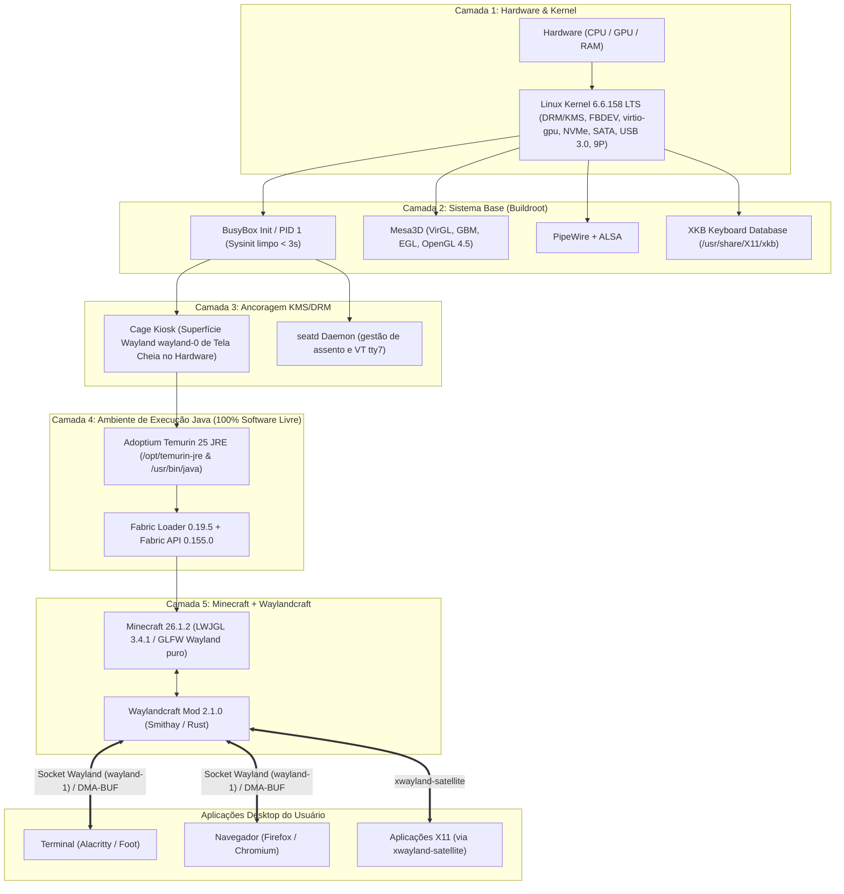

# MineOS: Minecraft como Compositor Gráfico Wayland 3D

> **"Simplicidade brutal no backend e a loucura total no frontend."**

O **MineOS** é um sistema operacional minimalista (**JeOS - Just Enough OS**) construído a partir do zero via **Buildroot (LTS 2025.02)**. Seu propósito é transformar o **Minecraft 26.1.2** no próprio **Compositor Gráfico Wayland** da máquina baremetal através do mod **Waylandcraft 2.1.0**, executando aplicações nativas do Linux (terminais, navegadores e jogos) renderizadas em blocos, quadros e superfícies tridimensionais no mundo do jogo.

---

## 🏛️ Os 4 Pilares da Filosofia

1. **Boot Mágico**: Liga a máquina, exibe informações de boot ultra-rápidas por ~3 segundos e pisca direto no menu inicial do Minecraft.
2. **"Just Enough OS" (JeOS)**: O Linux por baixo só existe para três coisas: gerenciar hardware (CPU/RAM), carregar drivers de vídeo acelerados (GPU virgl/DRM/KMS) e rodar a JVM.
3. **Minecraft como Compositor**: O mod Waylandcraft (Smithay/Rust + Fabric Java) atua como o servidor de janelas (`wayland-1`), lidando com inputs e janelas diretamente no mundo 3D.
4. **Imutabilidade e Persistência 9P VirtFS**: O sistema base (Kernel e rootfs) é montado em modo somente-leitura. Persistência de dados e mods do `.minecraft` é compartilhada em tempo real via **9P VirtFS** (`mc_data`) com overhead nulo de disco no host.

---

## 🏗️ Arquitetura do Sistema



---

## 📂 Estrutura do Repositório

```
MineOS/
├── README.md                          # Documentação central do projeto
├── ARCHITECTURE.md                    # Especificação arquitetural detalhada
├── MineOS.md                          # Manifesto original do projeto
│
├── buildroot/                         # Buildroot LTS 2025.02 (baixado sob demanda via tools/build_os.sh)
├── buildroot-external/                # Árvore externa BR2_EXTERNAL do MineOS
│   ├── external.desc                  # Descritor da árvore externa
│   ├── configs/
│   │   └── mineos_defconfig           # Configuração do SO (toolchain, Mesa, Wayland, Cage 0.2.0, XKB)
│   ├── patches/                       # Patches upstream aplicados via BR2_GLOBAL_PATCH_DIR
│   │   └── cage/                      # Patch pointer-constraints para o Cage 0.2.0 / wlroots 0.18
│   └── board/mineos/
│       ├── linux.fragment             # Opções de kernel 6.6 LTS (DRM, virtio-gpu, NVMe, SATA, 9P)
│       ├── post-build.sh              # Permissões, JRE Temurin e instalação do libwaylandcraft.so
│       └── rootfs-overlay/            # Arquivos mesclados no sistema final
│           ├── etc/inittab            # Sysinit do BusyBox (proc, sysfs, devpts, dev/shm)
│           ├── etc/init.d/S99mineos   # Script de boot (usuário, 9P, seatd, Cage Kiosk)
│           ├── opt/mineos/start-minecraft.sh # Lançador da JVM (Wayland puro, flags de debug)
│           └── usr/share/X11/xkb/     # Banco de dados de teclados para libxkbcommon
│
├── tools/                             # Ferramentas de desenvolvimento e automação
│   ├── build_os.sh                    # Orquestrador de compilação do Buildroot (download automático)
│   ├── download_deps.sh               # Download verificado por SHA-256 do Adoptium Temurin 25 JRE
│   ├── qemu_run.sh                    # Runner QEMU com KVM, VirGL, 9P VirtFS, QMP e SDL2
│   ├── observe_boot.py                # Observador automatizado de boot com categorização de logs
│   ├── vnc_screenshot.py              # Grabber de framebuffer via RFB/VNC para virgl 3D scanout
│   ├── check_wayland.c                # Diagnóstico nativo C para validação de sockets e GLFW
│   ├── qemu_qmp.py                    # Cliente QMP para controle da VM
│   └── mcp/
│       └── mineos_mcp_server.py       # Servidor Model Context Protocol (Stdio JSON-RPC)
│
├── waylandcraft-2.1.0/                # Mod Compositor Waylandcraft
│   ├── native/                        # Componente Smithay em Rust (libwaylandcraft.so)
│   ├── native-libs/                   # Binários nativos pré-compilados do Smithay (12 MB stripped)
│   └── src/                           # Código Java / Mixins do Fabric (compilado para Java 25)
│
└── tests/                             # Suíte de testes automatizados (pytest)
    ├── test_buildroot_config.py       # Validação da integridade da árvore externa e overlays
    ├── test_qemu_infrastructure.py    # Teste de inicialização e comunicação QEMU/QMP
    ├── test_rust_unit.py              # Testes unitários do componente nativo Smithay
    └── test_mcp_server.py             # Teste do servidor de telemetria MCP
```

---

## 🚀 Guia Rápido de Uso

### 1. Pré-requisitos
No Linux (Ubuntu/Debian, Fedora ou Arch):
```bash
# Ubuntu / Debian
sudo apt install build-essential git libncurses-dev flex bison curl qemu-system-x86 python3-pytest
```

### 2. Compilar a Imagem do Sistema Operacional (Buildroot 2025.02 LTS)
O MineOS adota o padrão modular **BR2_EXTERNAL**. O código-fonte do Buildroot e os tarballs externos são baixados sob demanda com integridade verificada:
```bash
# Baixa dependências (Adoptium Temurin 25 JRE), Buildroot 2025.02 e aplica defconfig
./tools/build_os.sh --defconfig

# Inicia a compilação paralela do sistema operacional completo (gera rootfs.ext4 em buildroot/output/images/)
./tools/build_os.sh --build
```

### 3. Executar e Testar a Máquina Virtual

#### Interativo (Janela Gráfica SDL2 com KVM e VirGL 3D):
```bash
./tools/qemu_run.sh
```

#### Headless com Observador Automatizado de Boot:
```bash
python3 tools/observe_boot.py
```

### 4. Rodar a Suíte de Testes
```bash
python3 -m pytest tests/
```

### 5. Compilar o Mod Waylandcraft (Opcional - Desenvolvimento)
```bash
cd waylandcraft-2.1.0
./gradlew build
```

---

## 🔍 Resumo dos Marcos Resolvidos

| Problema Encontrado | Causa Raiz Identificada | Solução Implementada |
| :--- | :--- | :--- |
| **"Display output is not active"** | Kernel 6.6 não tinha emulação de framebuffer (`CONFIG_DRM_FBDEV_EMULATION=n`). | Adicionado `CONFIG_DRM_FBDEV_EMULATION=y` ao fragmento de kernel. |
| **Falha do alocador do wlroots** | `/sys` não estava montado porque o `inittab` suprimia o `mount -a`. `libdrm` falhava ao verificar nós de dispositivos. | Corrigido `/etc/inittab` com montagem padrão de `/proc`, `/sys`, `/dev/pts`, `/dev/shm`. |
| **Falha GLFW X11: Failed to load Xlib** | Mojang força `GLFW_PLATFORM_X11` a menos que `DEBUG_PREFER_WAYLAND` seja verdadeiro, o qual exige `-DMC_DEBUG_ENABLED=true`. | Configurado `-DMC_DEBUG_ENABLED=true -DMC_DEBUG_PREFER_WAYLAND=true` e variáveis `GLFW_PLATFORM=wayland`. |
| **Falha de Inicialização do XKB** | `libxkbcommon` exigia o banco de dados de teclados em `/usr/share/X11/xkb`. | Instalado `/usr/share/X11/xkb` e habilitado `BR2_PACKAGE_XKEYBOARD_CONFIG=y`. |
| **Overhead de Disco do Host** | Imagens `.minecraft` duplicadas consumiriam todo o espaço livre (~3.4GB). | Configurado **9P VirtFS** (`mc_data`) montando `~/.minecraft` diretamente no guest sem cópias. |
| **Mouse/Input sem Interação** | Wlroots inicializado com `WLR_BACKENDS=drm` suprimia o backend `libinput`. | Removida restrição de backend para inicialização automática do `libinput`, liberado `/dev/input/*` com `seatd`. |
| **Crash no Spawn do Mundo** | Blaze3D alocava buffers de 32MB estourando `max_hostmem=256MB` no VirGL, gerando NPE em cadeia. | Expandido QEMU para `max_hostmem=1G`, RAM `2560M` e criados Mixins defensivos para `player == null`. |
| **Trava de Câmera 360° no Wayland** | Cage 0.1.5 não expunha `relative-pointer-v1` nem `pointer-constraints-v1`; GTK no host não suportava travas Wayland. | Criado patch permanente para o Cage Kiosk adicionando ambos os protocolos; migrado runner host para SDL2 com `-device virtio-mouse-pci`. |
| **Engasgo Severo em Tela Cheia** | Wlroots ativava Direct Scanout no KMS virtual, bloqueando page flips e congelando a render thread. | Exportado `WLR_SCENE_DISABLE_DIRECT_SCANOUT=1` e `WLR_DRM_NO_ATOMIC=1`, mantendo composição GLES2 fluida a 60 FPS. |
| **Cursor Invertido e Cliques na UI** | Driver VirGL ignora `Y_0_TOP` em planos de hardware DRM (inversão de 180° e desvio de hotspot); host cursor vazava no SDL. | Exportado `WLR_NO_HARDWARE_CURSORS=1` para software cursors via OpenGL e adicionado `show-cursor=off` ao SDL2. |

---

## 📜 Licença

Distribuído sob a licença [MIT](file:///home/nubi/Documents/MineOS/LICENSE). Veja `LICENSE` para mais informações.
O mod Waylandcraft contém componentes sob licença MIT/GPLv3 em harmonia com o ecossistema Fabric e Smithay.
